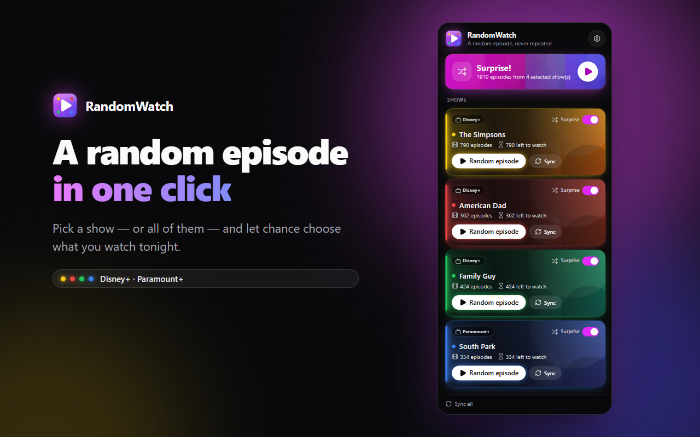
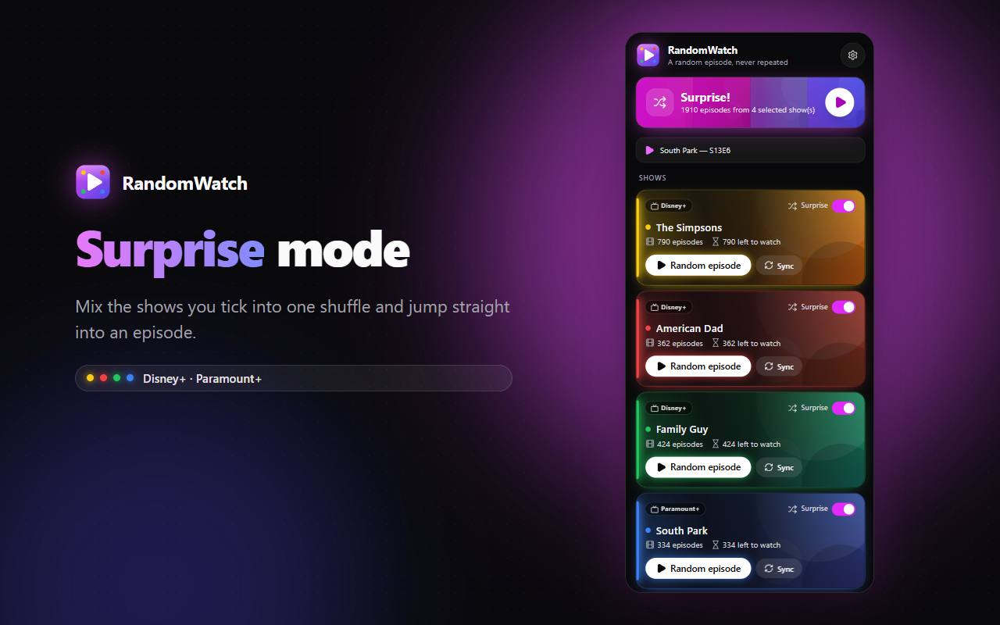
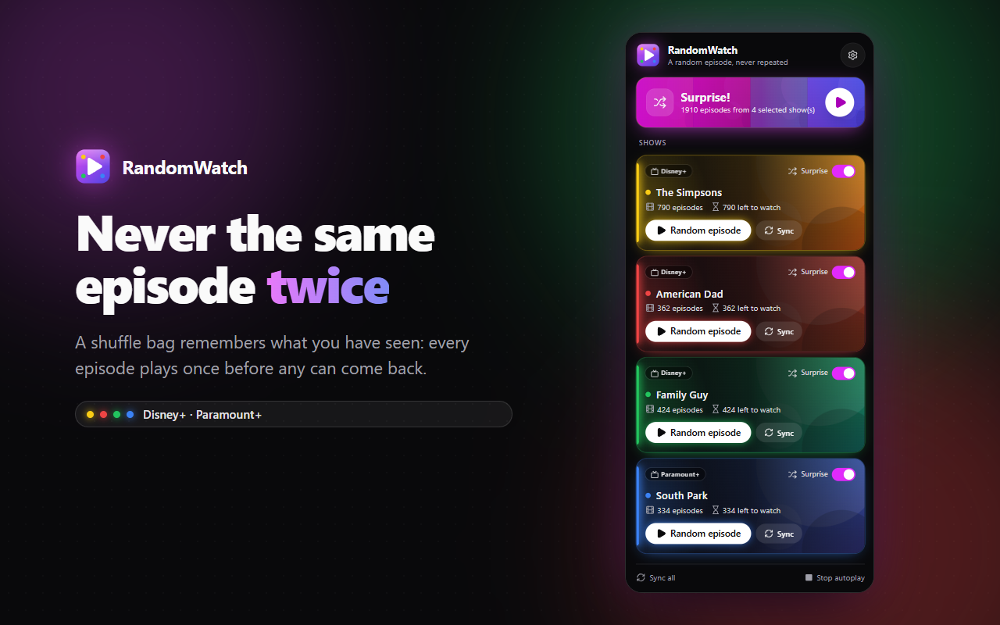
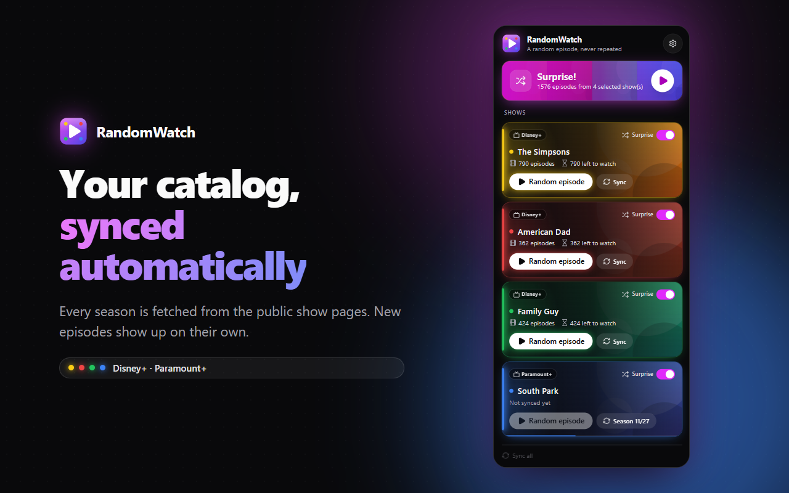
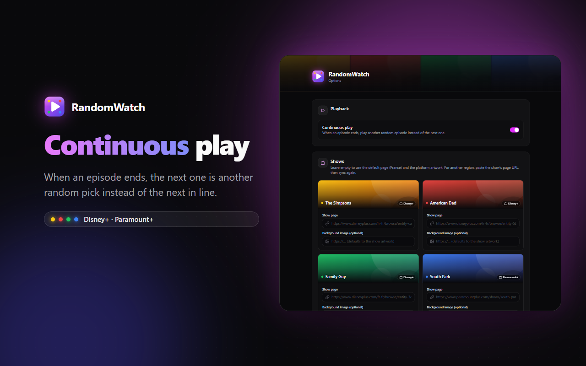

<p align="center">
  
</p>

<p align="center">
  <b>Random episodes of The Simpsons, American Dad, Family Guy and South Park on Disney+ and Paramount+, with no repeats.</b><br>
  A browser extension for Chrome and Firefox, in English and French.
</p>

<p align="center">
  <a href="https://chromewebstore.google.com/detail/randomwatch/odlemafbmajipdoppggjnonkjjhifphc"></a>
  <a href="https://addons.mozilla.org/firefox/addon/randomwatch/"></a>
</p>

<p align="center">
  
  
  
</p>

<p align="center">
  
</p>

> 🇫🇷 **En français :** RandomWatch lance un épisode au hasard des Simpson, d'American Dad, des Griffin (Disney+) ou de South Park (Paramount+), sans jamais rejouer un épisode avant que tous les autres soient passés. L'extension est en français ou en anglais selon la langue du navigateur.

## Features

| | |
| --- | --- |
|  |  |
| **One click, one random episode.** Pick a show and the episode opens in your Disney+ or Paramount+ tab. | **Surprise mode.** Tick the shows you want and draw from all of them in one shuffle. |
|  |  |
| **Never the same episode twice.** A shuffle bag plays every episode once before any can come back. Each show and Surprise mode keep their own history. | **Catalog synced automatically.** Every season is read from the show's page, so new episodes show up at the next sync. |
|  | |
| **Continuous play.** When an episode ends, the next one is a new random pick instead of the next in line. | |

There are also custom background images per show, the show page URL for each region, and a reset for the history.

> The images above use placeholder backgrounds. In the extension, each card shows the show's own artwork.

## Supported shows

| Show | Platform |
| --- | --- |
| The Simpsons | Disney+ |
| American Dad | Disney+ |
| Family Guy | Disney+ |
| South Park | Paramount+ |

You need your own subscription. RandomWatch only opens episodes in your browser. It does not download, host or unlock any content.

## Install

- **Chrome** (and Edge, Brave, Opera): [Chrome Web Store](https://chromewebstore.google.com/detail/randomwatch/odlemafbmajipdoppggjnonkjjhifphc)
- **Firefox**: [Firefox Add-ons](https://addons.mozilla.org/firefox/addon/randomwatch/)

Then open the popup and press **Sync all** once while you are signed in to Disney+ and Paramount+.

## Install from source

Requires Node.js 20+.

```bash
npm install
npm run build          # Chrome  → .output/chrome-mv3
npm run build:firefox  # Firefox → .output/firefox-mv2
```

- **Chrome:** open `chrome://extensions`, turn on *Developer mode*, click *Load unpacked* and pick `.output/chrome-mv3`.
- **Firefox:** open `about:debugging#/runtime/this-firefox`, click *Load Temporary Add-on* and pick `.output/firefox-mv2/manifest.json`.

Then open the popup and press **Sync all** once while you are signed in to Disney+ and Paramount+.

## Development

| Command | What it does |
| --- | --- |
| `npm run dev` / `npm run dev:firefox` | Starts a browser with the extension and hot reload |
| `npm test` | Runs the unit tests (Vitest) |
| `npm run compile` | Type-checks the project |
| `npm run zip` / `npm run zip:firefox` | Builds the packages to upload to the stores |
| `npm run icons` | Renders the PNG icons from `assets/logo.svg` |
| `npm run store` | Renders the store screenshots, promo tiles and video into `store/out` |

### How it works

- **`lib/picker.ts`**: the shuffle bag. It refills and reshuffles once every episode has been played. It makes sure the last episode of a cycle is not the first of the next one, and it follows catalog changes after a sync.
- **`lib/sync/`**: catalog sync. For Disney+ it reads the show page data (`__NEXT_DATA__`). For Paramount+ it uses the episode list endpoint the site itself calls.
- **`entrypoints/background.ts`**: draws episodes, opens or reuses the player tab, and runs the syncs.
- **`entrypoints/player.content.ts`**: detects the end of an episode for continuous play.
- **`public/_locales/`**: English and French strings.

Built with [WXT](https://wxt.dev), React 19, Tailwind CSS 4 and lucide-react.

## Privacy

RandomWatch collects nothing. It has no account, no analytics and no server of its own. The catalog, history and settings stay in your browser's local storage.

## Disclaimer

RandomWatch is an independent project. It is not affiliated with, endorsed by or sponsored by Disney, Paramount, 20th Television, Fox or Comedy Central. Show names and trademarks belong to their respective owners.
